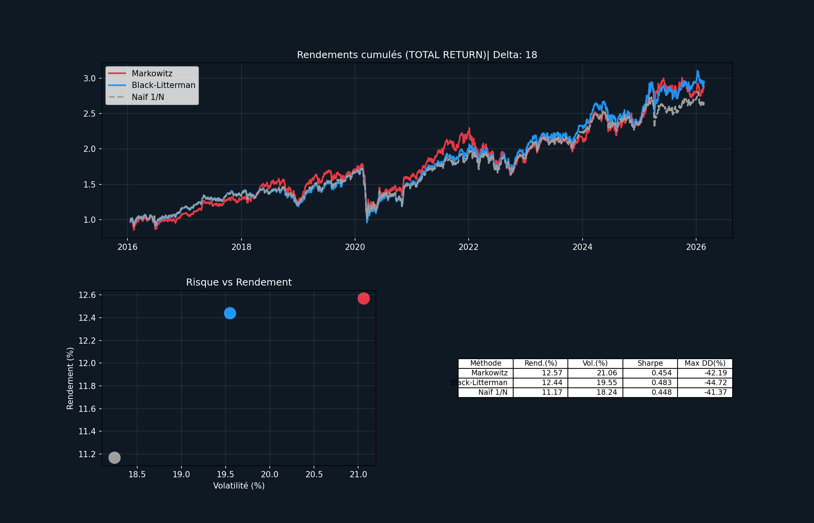
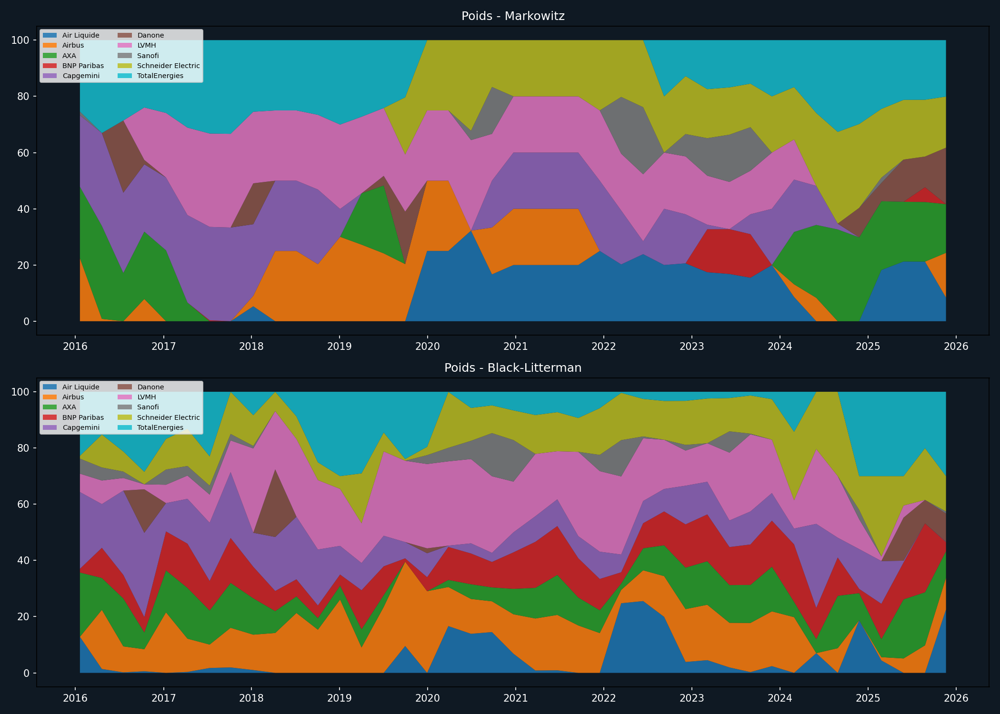

# Black-Litterman Portfolio Optimisation with EGARCH-M Views

Asset allocation engine that addresses the main weakness of Markowitz mean-variance optimisation, its **sensitivity to estimation error**. It combines three building blocks:

- **Black-Litterman**: a Bayesian update that anchors expected returns on market equilibrium (CAPM-implied returns).
- **Ledoit-Wolf shrinkage**: makes the covariance matrix more robust.
- **EGARCH-M**: generates the views *endogenously*. The conditional return forecast becomes the view vector **Q**, and the conditional variance forecast becomes the view uncertainty **Ω**.

The strategies are backtested on **10 CAC 40 stocks (2007–2026)** with a 4-year rolling window and quarterly rebalancing, against Markowitz and an equal-weighted 1/N portfolio.

> First-year research project (*Projet d'Études n°26*) at **École Centrale de Lyon**, 2025–2026.
> Full report (in French): [`report/PE26_final_report_FR.pdf`](report/PE26_final_report_FR.pdf)

---

## Key results (out-of-sample, 2016–2025)

| Strategy | Ann. return | Volatility | Sharpe | Max drawdown |
|---|---:|---:|---:|---:|
| Markowitz (sample covariance) | 12.57 % | 21.06 % | 0.454 | −42.19 % |
| Naive 1/N | 11.17 % | 18.24 % | 0.448 | −41.37 % |
| Black-Litterman, δ = 1 | 11.77 % | 21.67 % | 0.405 | −50.57 % |
| Black-Litterman, δ = 10 | 12.39 % | 21.35 % | 0.440 | −49.09 % |
| **Black-Litterman, δ = 18** | **12.44 %** | **19.55 %** | **0.483** | −44.72 % |
| Black-Litterman, δ = 100 | 11.25 % | 18.12 % | 0.455 | −41.61 % |
| Black-Litterman, δ = −5.5 *(exploratory)* | 14.96 % | 20.65 % | 0.579 | −52.79 % |

Full table: [`results/report_summary.csv`](results/report_summary.csv)

- **The risk-aversion δ sets the balance** between the market prior and the EGARCH-M signals.
  - At **δ = 18**, the strategy keeps Markowitz-level returns with 1.5 pts less volatility and the best Sharpe ratio among positive δ.
  - **Low δ** overweights the directional views, which leads to a −50 % drawdown during the COVID crash.
  - **High δ** collapses to the 1/N portfolio.
- **Negative δ** flips the equilibrium prior, so the model only buys the assets with the strongest EGARCH-M signals. This gives the best raw performance. It is reported as an algorithmic curiosity, though: it was selected on the evaluation sample and is very likely overfitted.



<details>
<summary>Portfolio weights over time (Markowitz vs Black-Litterman, δ = 18)</summary>



Markowitz produces "bang-bang" allocations (assets jumping between 0 % and the cap). Black-Litterman keeps much smoother and more diversified weights.
</details>

---

## Method

At each quarterly rebalancing date *t*, using only the previous 1,000 trading days:

1. **Covariance.** Apply Ledoit-Wolf shrinkage of the sample covariance *S* toward a constant-correlation target *F*:  
   Σ = λ\* F + (1 − λ\*) S, with the optimal intensity λ\* estimated from the data.
2. **Prior.** Compute the equilibrium returns Π = δ Σ w<sub>mkt</sub>.
3. **Views.** For each stock, estimate an EGARCH(1,1)-M model with Student-t innovations:
   - mean equation: r<sub>t</sub> = μ + λ σ²<sub>t</sub> + ε<sub>t</sub>
   - variance equation: asymmetric EGARCH, which captures the leverage effect.

   The two equations are estimated alternately until (μ, λ) converge. The one-step-ahead forecasts give the views:  
   **Q<sub>i</sub> = μ̂ + λ̂ σ̂²<sub>T+1</sub>** and **Ω = diag(σ̂²<sub>T+1</sub>)**.
4. **Bayesian update.**
   - μ<sub>BL</sub> = [(τΣ)⁻¹ + Ω⁻¹]⁻¹ [(τΣ)⁻¹Π + Ω⁻¹Q]
   - Σ<sub>BL</sub> = Σ + [(τΣ)⁻¹ + Ω⁻¹]⁻¹
   - τ is auto-calibrated so that Ω / τΣ ≈ 1.
5. **Allocation.** Find the max-Sharpe portfolio on (μ<sub>BL</sub>, Σ<sub>BL</sub>): long-only, fully invested, at most 30 % per stock.

**Robustness safeguards:**
- views bounded to Π ± one annual volatility;
- Ω floored at τΣ<sub>ii</sub>;
- empirical fallback if an EGARCH fit fails.

**Universe** (sector-diversified): Air Liquide, Airbus, AXA, BNP Paribas, Capgemini, Danone, LVMH, Sanofi, Schneider Electric, TotalEnergies.  
**Returns** are total-return log returns, with a 3 % annual dividend yield added daily.

---

## Repository structure

```
├── src/bl_portfolio/
│   ├── config.py           # parameters, universe, market regimes
│   ├── data.py             # Investing.com loader, total-return log returns, synthetic data
│   ├── covariance.py       # Ledoit-Wolf (constant-correlation target)
│   ├── egarch_m.py         # iterative EGARCH-M → views Q, Ω
│   ├── black_litterman.py  # prior, posterior, full BL step
│   ├── optimizers.py       # max-Sharpe (SLSQP), Markowitz tangency
│   ├── backtest.py         # rolling walk-forward backtest
│   ├── metrics.py          # return, volatility, Sharpe, max drawdown
│   └── plotting.py
├── scripts/
│   ├── run_backtest.py     # CLI: one or several δ, one or several regimes
│   └── egarch_params.py    # full-sample EGARCH-M parameter table
├── tests/                  # unit tests (Ledoit-Wolf, BL limits, constraints)
├── results/                # report figures and summary table
├── report/                 # final report (PDF, French)
└── data/                   # price files (not versioned, see data/README.md)
```

## Quickstart

```bash
git clone https://github.com/nathaneb6/black-litterman-egarch.git
cd black-litterman-egarch
pip install -r requirements.txt

# Demo on simulated prices (no data needed)
python scripts/run_backtest.py --synthetic --delta 18 --scenarios 4_full_history

# Reproduce the report (put the 10 price files in data/ first, see data/README.md)
python scripts/run_backtest.py --data-dir data --delta 1 10 18 100 -5.5 --scenarios 4_full_history
python scripts/run_backtest.py --data-dir data --delta 18          # all four market regimes

pytest                                                             # unit tests
```

Figures and a `summary.csv` are written to `results/runs/`. EGARCH-M views do not depend on δ, so they are fitted once and cached when you sweep several values of δ.

## Limitations

- **No transaction costs.** The results are an upper bound. This mostly flatters Markowitz, whose turnover is the highest.
- **The dividend yield is a constant 3 %** for every stock, not the actual dividends.
- **δ was chosen on the evaluation period.** The selected values (δ = 18 and especially δ = −5.5) would need a separate validation period to be claimed as out-of-sample.
- **The Markowitz baseline** is the analytic tangency portfolio with constraints imposed by clipping, not a constrained optimisation.
- Metrics are computed on daily log returns compounded as simple returns, which is a small approximation.

## Team

Nathane Bessis, Alex Cesbron, Max Chalumeau, Corentin Gary, Ayman M'Khantar, Malcôme Salczer.  
Supervisors: Christian de Peretti, Denis Bouillet (École Centrale de Lyon).

## References

1. Markowitz, H. (1952). *Portfolio Selection*. Journal of Finance.
2. Black, F. & Litterman, R. (1992). *Global Portfolio Optimization*. Financial Analysts Journal.
3. Ledoit, O. & Wolf, M. (2004). *Honey, I Shrunk the Sample Covariance Matrix*. Journal of Portfolio Management.
4. Nelson, D. B. (1991). *Conditional Heteroskedasticity in Asset Returns: A New Approach*. Econometrica.
